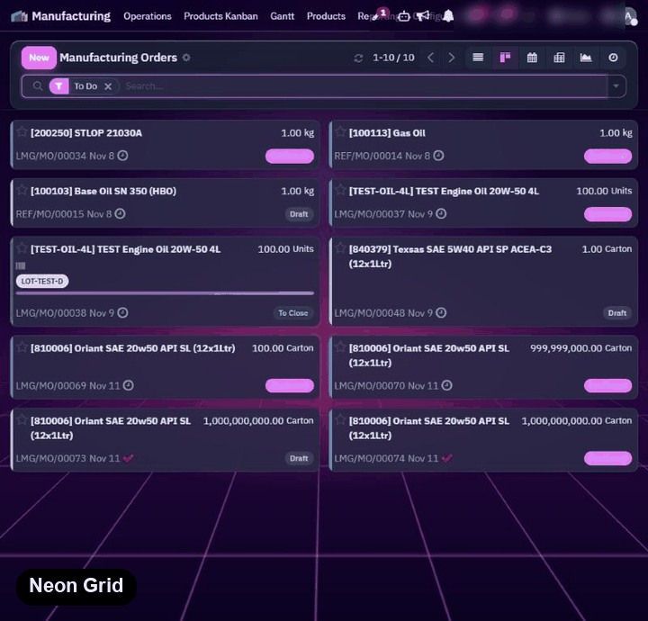

# Prism Theme Studio for Odoo 19

A free, creative backend theme for Odoo 19 where **every user picks his own look**, with a live preview.
Written from scratch, LGPL-3.

## Styles

All drawn in CSS (no image files): Aurora, Mesh Bloom, Desert Dunes, Midnight Sky, Glass Ocean, Paper Studio,
Emerald Arabesque, Sunset Horizon, Graphite, Neon Grid, plus **Follow the sun** (a style for each part of the day)
and **My photo** (your own picture, blurred, colours taken from it; or the company photo).

## Features

- **Inside every screen**: tinted frosted glass on forms, lists, kanban, calendar, pivot, chatter, dialogs and menus;
  accent colour on list headers, selected rows, tabs, status bar, kanban columns and search facets.
- **Dark styles are dark inside** (Odoo's dark mode), or always light / always dark per user.
- **Sidebar menu** (optional): collapsible, searchable, pinned favourites saved on the user.
- **My home**: greeting, live clock, Gregorian and Hijri date, today's occasion, pinned apps and app tiles.
- **Occasions by the Hijri calendar** (Umm al-Qura, built into the browser): Ramadan lanterns, Eid stars,
  Founding Day Sadu band, National Day ribbon, winter snow. Small, never in the way, can be switched off.
- **Studio** (colourful brush in the top bar): style, accent colour (swatches or any colour), seven fonts including
  Arabic modern / Arabic classic (fonts already on the computer), spacing, animation, effects, menu, occasions.
- **Effects automatic**: glass blur and animation are turned down on a slow computer (measured once when idle).
- **For the company** (Settings > Prism Theme): company style and accent colour for users without their own look,
  lock the look, company background photo, Prism on the login page.
- Mouse spotlight, card lift, button sheen, reduced-motion support, right-to-left ready, English and Arabic.

## How it works

- Install it: nothing changes until a user (or the company) switches it on.
- Settings are stored on the user (users change only their own) and travel with the session.
- Light / dark: an `ir.http.color_scheme` override plus the standard `color_scheme` cookie (read first by Odoo
  Enterprise), restored when the theme is switched off.
- Everything is scoped under `body.o_prism`.
- Odoo 19 Community and Enterprise; depends only on `web`.

Author: Marwan Algaber
