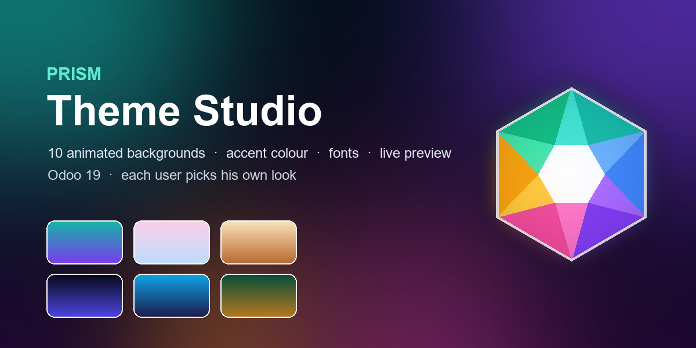

# Prism Theme Studio for Odoo 19

A backend theme where **every user picks his own look**, with a live preview. Written from scratch, LGPL-3.

## Styles

Eleven choices, all drawn in CSS (no image files to load):

| Style | Background |
|---|---|
| Follow the sun | changes with the time of day: dawn, day, sunset, evening, night |
| Aurora | moving northern lights |
| Mesh Bloom | soft pastel colour clouds |
| Desert Dunes | sand waves under a low sun |
| Midnight Sky | twinkling stars |
| Glass Ocean | frosted glass over deep blue |
| Paper Studio | drafting-paper grid |
| Emerald Arabesque | eight-point star pattern |
| Sunset Horizon | warm evening glow |
| Graphite | calm and minimal |
| Neon Grid | retro neon horizon with a moving grid |

## What changes

- Forms, lists and kanban columns float as cards on the background; frosted-glass top bar and control panel.
- Accent colour on buttons, status bars, tabs, switches and focus rings (nine swatches or any colour).
- A soft spotlight in the accent colour follows the mouse; kanban cards lift on hover; buttons get a light sheen.
- Five fonts (system families, nothing downloaded), comfortable or compact spacing.
- Animation on or off; still automatically when the computer asks for reduced motion.

## How it works

- Install it: nothing changes for anybody. Each user clicks the colourful brush in the top bar, switches the theme
  on and picks a style. Every click shows at once and is saved on the user (users can change only their own).
- The settings travel with the session, so the theme is drawn before the first screen.
- Everything is scoped under `body.o_prism`: with the theme off no screen is touched. Light and dark mode supported.
- Odoo 19 Community and Enterprise; depends only on `web`. English and Arabic.

Author: Marwan Algaber
